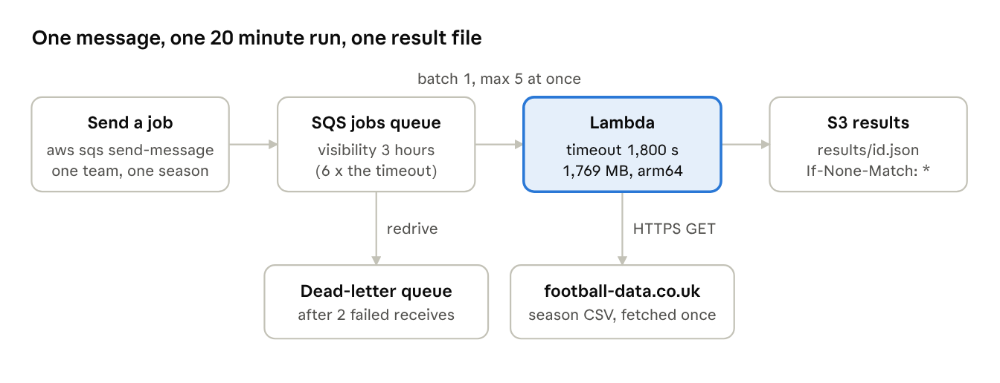
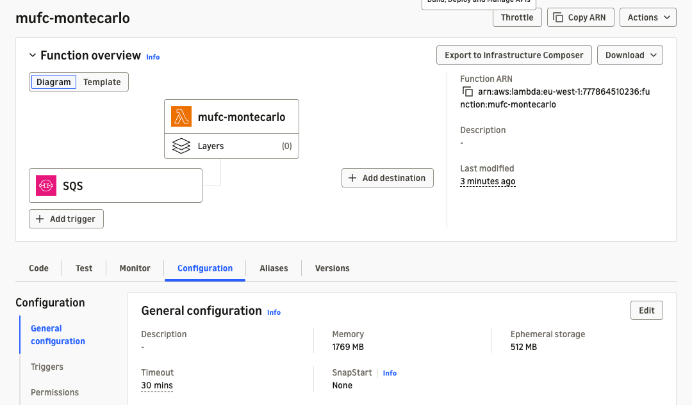
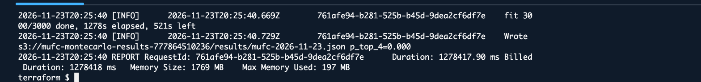
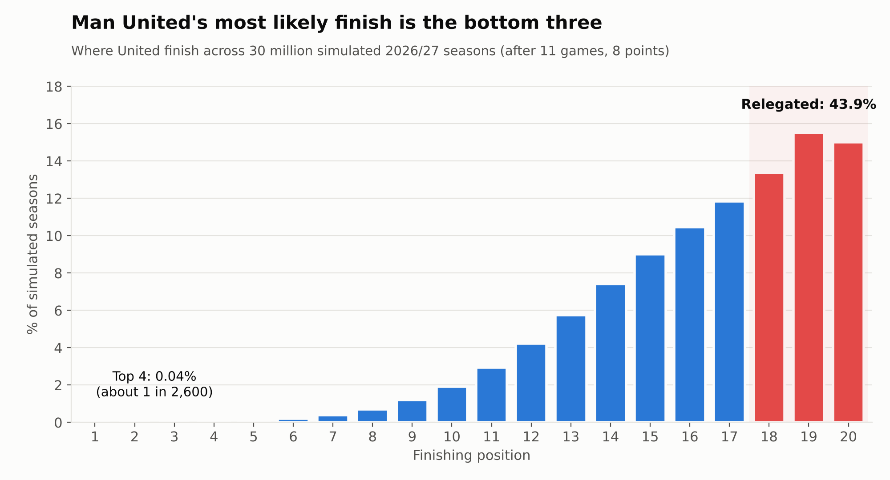
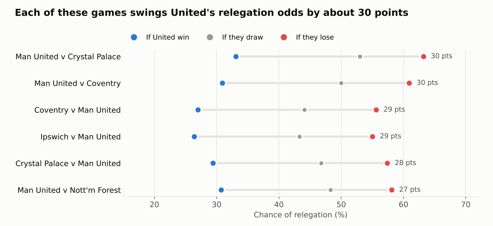

## Preface

Since 2018, "will it finish in 15 minutes?" has been the first question I ask before putting anything on Lambda. If the answer was "probably not", the job went to Fargate or Batch, or got chopped up with Step Functions to stay under the wall. In 2024 I wrote about [passing S3 properties to Batch via EventBridge](https://redm0nd.github.io/2024/09/02/S3-EventBridge-Batch.html), and honestly half the reason that pattern exists is that 15 minute limit.

On November 19th AWS [raised the on-demand Lambda timeout to 30 minutes](https://aws.amazon.com/blogs/compute/announcing-30-minute-timeout-for-on-demand-aws-lambda-event-functions/). I wanted to actually build something that needs more than 15 minutes and see what happens.

So I've built a Monte Carlo simulator that answers the question every United fan asks around this time of year: **can Man United still make the top 4?** It pulls this season's Premier League results from [football-data.co.uk](https://www.football-data.co.uk/englandm.php), fits a model of how good each team is, and plays out the rest of the season 30 million times in a single 21 minute Lambda invocation. It also works out which of United's remaining fixtures are the big ones.

Now, to be honest, anyone who's watched United this season already knows the answer. After 11 games they're **19th on 8 points**. They have one league win, a [5–2 against Ipswich back in August](https://www.si.com/soccer/man-utd-drop-relegation-zone-man-city-defeat-red-devils-40-year-low), and they're in the bottom three after nine games for the first time since 1986. They're not making the top 4, but I wanted to put an actual number on it, and while I'm at it, one on relegation too.

By the end of this post you'll have:

- An SQS → Lambda → S3 pipeline in Terraform with a 30 minute timeout
- The Python simulator, with no framework and only numpy
- The gotchas to watch out for with long-running functions
- Deploy, verify and clean-up steps

All the code is on GitHub: [Redm0nd/mufc-montecarlo](https://github.com/Redm0nd/mufc-montecarlo)

## What actually changed (and what didn't)

The headline is "Lambda now runs for 30 minutes", but that's only true for **Event Functions**, the classic event-driven Lambda. There's a bit more to it, here's the breakdown from the [announcement](https://aws.amazon.com/blogs/compute/announcing-30-minute-timeout-for-on-demand-aws-lambda-event-functions/):

| Lambda type | Sync | Async | Event source mapping |
| --- | --- | --- | --- |
| Event Functions, on demand | 30 min | 30 min | 30 min |
| Event Functions, Managed Instances | 30 min | 90 min | 90 min |
| Web Functions | 15 min | 15 min | 15 min |

A few gotchas I'd have missed if I'd only read the headline:

- **Not every event source mapping gets it.** Amazon MQ and DocumentDB mappings stay at 14 minutes. So do Kafka mappings created before November 19th, unless you recreate them or turn on provisioned mode.
- **Init is still 10 seconds** on demand. Your handler gets 30 minutes, but your imports don't.
- **The caller has its own timeout.** If you invoke synchronously through something with a shorter timeout, that timeout wins. This is why I'm using SQS and not an API.
- **It only applies to invocations that start after you change it.** An event source mapping can take a few minutes to pick it up.

The Kafka one is something to be aware of. Existing mappings won't break, but they also won't get the new limit and you won't get any warning about it.

## How it fits together



The setup itself is pretty simple. A message on the queue says which team and season to simulate. One Lambda picks it up, pulls the season's CSV, runs for 15 to 25 minutes and writes a JSON file to S3. Anything that fails twice ends up in the DLQ.

Why SQS and not API Gateway or a function URL? Nobody wants to hold an HTTP connection open for 20 minutes, and the caller's own timeout is what limits a synchronous call. With a queue I get retries, a DLQ and back-pressure for free.

## The simulation

I'm not a data scientist and the model is deliberately simple. It's the [Maher (1982)](https://en.wikipedia.org/wiki/Poisson_regression) approach that most football models start from. Every team gets an **attack** and a **defence** rating, plus there's one **home advantage** number. A match's expected goals are:

```
home goals ~ Poisson(home_adv * attack[home] * defence[away])
away goals ~ Poisson(attack[away] * defence[home])
```

The ratings are fitted from this season's results. Then every remaining fixture is played out with random Poisson goals, the table is built, and we record where United finished. Do that enough times and you get a probability for every position.

There's two things that make it a bit more realistic, and also make it slow:

1. **Bootstrapping.** Twelve games into a season, nobody really knows how good anyone is. So rather than fitting once, I resample the played matches with replacement, refit the ratings, and simulate from that. I repeat that 3,000 times. That way the uncertainty is built into the answer, rather than trusting one set of ratings.
2. **The big games.** For each of United's remaining fixtures, I track P(top 4 | win) and P(top 4 | loss). The gap between them is that match's *swing*. It comes free from the same simulations; it just needs a lot of them to be stable.

That's 3,000 fits × 10,000 seasons = **30 million simulated seasons** per request. I started at 2,000 fits, but a quick smoke test showed Lambda doing about 0.42 seconds per fit, so 2,000 would have finished in around 14 minutes. That's under the old limit, which would have made this a pretty pointless post. At 3,000 fits it took 21 minutes.

> Is 30 million overkill for the headline number? Probably. But the swing figures are conditional on a third of the simulations each, and they jump around a lot below a few million. In testing, the top-4 number moved by 8 points between 50 and 100 bootstrap fits on the same data. So I stuck with the bigger number.

The core of the handler, with the full file in the repo:

```python
def handler(event, context):
    failures = []
    for record in event["Records"]:
        try:
            job = json.loads(record["body"])
            key = f"results/{job['request_id']}.json"

            # Idempotency: SQS is at-least-once and a 30 minute run is a big
            # window for a duplicate. If the result already exists, skip.
            try:
                s3.head_object(Bucket=RESULTS_BUCKET, Key=key)
                log.info("Result %s already exists, skipping duplicate", key)
                continue
            except ClientError as e:
                if e.response["Error"]["Code"] not in ("404", "NoSuchKey", "NotFound"):
                    raise

            result = run(job, context)
            try:
                # If-None-Match: * means a racing duplicate can't overwrite us
                s3.put_object(Bucket=RESULTS_BUCKET, Key=key, IfNoneMatch="*",
                              Body=json.dumps(result, indent=2),
                              ContentType="application/json")
            except ClientError as e:
                if e.response["Error"]["Code"] != "PreconditionFailed":
                    raise
        except Exception:
            log.exception("Failed processing message %s", record["messageId"])
            failures.append({"itemIdentifier": record["messageId"]})
    return {"batchItemFailures": failures}
```

The bootstrap loop keeps an eye on the clock. When there's less than a minute left it stops, writes what it has, and tells you it stopped early. The last thing you want is the function being killed at 1,800 seconds with nothing written:

```python
for b in range(bootstrap_fits):
    if context.get_remaining_time_in_millis() < SAFETY_MARGIN_MS:
        log.warning("Stopping early at fit %d/%d to avoid timeout", b, bootstrap_fits)
        break
    sample = rng.integers(0, len(played), len(played))
    att, dfn, home = fit(hi[sample], ai[sample], hg[sample], ag[sample], n)
    pos, res = simulate(att, dfn, home, base_pts, base_gd, fx_h, fx_a, sims_per_fit, rng, t)
    ...
```

One thing I got wrong first time: some bootstrap samples leave a team with zero goals scored. That gives an attack rating of 0, which then divides by zero. numpy happily produces `NaN`s, and it all falls over at `rng.poisson()` with `lam value too large`. The fix was a small prior: every team gets a couple of pseudo-matches against an average side. It also stops the model over-trusting a hot first month.

I also didn't need a fixtures feed. Every team plays every other team home and away, so any pairing not yet in the results is still to come.

## The Terraform

The AWS post only shows CLI and SAM examples, so here it is in Terraform. CloudFormation fans, I'm one of you, but this is the one we use in work. There are four pieces: a results bucket, a queue with a DLQ, the function, and the event source mapping. I've skipped the boring bits (IAM, public access block, log group), which are in the repo.

The first gotcha is with the queue:

```hcl
locals {
  # AWS guidance: SQS visibility timeout >= 6x the function timeout.
  # For a 30 minute function that's 3 hours. Lambda itself only enforces
  # visibility >= 1x the timeout, and only when the event source mapping is
  # created or updated - raising the function timeout later isn't checked.
  visibility_timeout = var.timeout_seconds * 6
}

resource "aws_sqs_queue" "jobs" {
  name                       = "${var.name}-jobs"
  visibility_timeout_seconds = local.visibility_timeout
  message_retention_seconds  = 86400

  redrive_policy = jsonencode({
    deadLetterTargetArn = aws_sqs_queue.dlq.arn
    maxReceiveCount     = 2
  })
}
```

This is the one to watch out for. The 6× figure is only a recommendation, to leave room for throttling retries. What Lambda actually enforces is that the visibility timeout is at least the function timeout, and it only checks that when the mapping is created or updated. So a queue at 900 seconds passed the check happily for a 15 minute function. Bump that function to 1800 and nothing complains, but at minute 15 the message becomes visible again and a second invocation picks up the same job. Tying both values to the one variable means they can't drift apart.

The function:

```hcl
resource "aws_lambda_function" "sim" {
  function_name    = var.name
  role             = aws_iam_role.lambda.arn
  handler          = "handler.handler"
  runtime          = "python3.14"
  architectures    = ["arm64"]
  filename         = data.archive_file.lambda.output_path
  source_code_hash = data.archive_file.lambda.output_base64sha256

  # The AWS provider still validates timeout as 1-900, see below
  timeout     = 900
  memory_size = 1769 # one full vCPU - numpy here is single threaded so more won't help

  # Cap how many 30 minute runs can be going at once (and the bill).
  reserved_concurrent_executions = 5

  environment {
    variables = {
      RESULTS_BUCKET   = aws_s3_bucket.results.bucket
      SAFETY_MARGIN_MS = "60000"
    }
  }

  lifecycle {
    ignore_changes = [timeout]
  }
}

resource "aws_lambda_event_source_mapping" "jobs" {
  event_source_arn        = aws_sqs_queue.jobs.arn
  function_name           = aws_lambda_function.sim.arn
  batch_size              = 1
  function_response_types = ["ReportBatchItemFailures"]

  scaling_config {
    maximum_concurrency = 5
  }
}
```

### The Terraform provider doesn't know about 30 minutes yet

This one caught me out when I went to deploy. My first `terraform apply` with `timeout = 1800` failed straight away, on the latest AWS provider (v6.73.0):

```
Error: expected timeout to be in the range (1 - 900), got 1800

  with aws_lambda_function.sim,
  on main.tf line 147, in resource "aws_lambda_function" "sim":
 147:   timeout     = var.timeout_seconds
```

The provider has its own validation hardcoded at 900 seconds, so it rejects the value before it ever reaches the Lambda API. If you read my [CloudFormation vs. Terraform](https://redm0nd.github.io/2024/03/18/CFN-vs-TF.html) post, you'll know this is a pattern. New AWS features often land in Terraform a while after launch, and this one was announced four days ago.

The workaround until the provider catches up: create the function at 900 with Terraform, then bump it with the AWS CLI. `ignore_changes` stops Terraform from flipping it back on the next apply:

```hcl
resource "terraform_data" "lambda_timeout" {
  triggers_replace = [var.timeout_seconds, aws_lambda_function.sim.source_code_hash]

  provisioner "local-exec" {
    command = <<-EOT
      aws lambda wait function-updated-v2 --region ${var.region} --function-name ${aws_lambda_function.sim.function_name}
      aws lambda update-function-configuration --region ${var.region} --function-name ${aws_lambda_function.sim.function_name} --timeout ${var.timeout_seconds} --query Timeout
      aws lambda wait function-updated-v2 --region ${var.region} --function-name ${aws_lambda_function.sim.function_name}
    EOT
  }
}
```

The event source mapping also gets a `depends_on = [terraform_data.lambda_timeout]`, so SQS doesn't start invoking the function while it's still at 15 minutes. It's not pretty, but it works, and you can delete it once the provider supports 1800. CloudFormation and SAM don't have this problem, because they pass the value straight through to the API.

A few decisions worth explaining:

- **`memory_size = 1769`** is the point where Lambda gives you one full vCPU. The simulation runs on one thread, so going to 4 GB would mostly just cost more. If you rework it to use `multiprocessing`, then more memory is worth it.
- **`batch_size = 1`**, because a batch of 10 jobs at 20 minutes each won't fit in any timeout. One job per invocation keeps it simple.
- **`reserved_concurrent_executions = 5`**. A long function ties up concurrency for a long time. More on that below.
- **arm64**, because Graviton is cheaper per GB-second and numpy ships aarch64 wheels.

numpy needs packaging for the right platform. If you build the zip on a Mac and ship it, you'll get an `ImportError` at runtime. `build.sh` handles that:

```bash
pip install numpy \
  --platform manylinux_2_28_aarch64 \
  --python-version 3.14 \
  --only-binary=:all: \
  --target build
cp src/handler.py build/
```

## Deploy and run it

```bash
git clone https://github.com/Redm0nd/mufc-montecarlo.git && cd mufc-montecarlo
bash build.sh
cd terraform
terraform init
terraform apply -var region=eu-west-1
```

I deployed from CloudShell, which brings up one more small gotcha. CloudShell's home directory is only 1GB, and the AWS provider binary alone is several hundred MB, so `terraform init` failed with `no space left on device`. Pointing Terraform's data dir at `/tmp` sorts it:

```bash
export TF_DATA_DIR=/tmp/tfdata
```

Once it's applied, the console shows the function at 30 minutes:



Then drop a job on the queue. `2627` is football-data.co.uk's code for the 2026/27 season:

```bash
aws sqs send-message \
  --queue-url "$(terraform output -raw queue_url)" \
  --message-body '{"request_id":"mufc-2026-11-23","season":"2627","team":"Man United","bootstrap_fits":3000,"sims_per_fit":10000,"seed":2026}'
```

Watch it go. The handler logs progress every 25 fits:

```bash
aws logs tail /aws/lambda/mufc-montecarlo --follow
```

```
2026-11-23T20:11:41 [INFO] fit 1025/3000 done, 439s elapsed, 1360s left
2026-11-23T20:11:52 [INFO] fit 1050/3000 done, 450s elapsed, 1350s left
[...]
2026-11-23T20:25:40 [INFO] fit 3000/3000 done, 1278s elapsed, 521s left
2026-11-23T20:25:40 [INFO] Wrote s3://mufc-montecarlo-results-<account-id>/results/mufc-2026-11-23.json p_top_4=0.000
2026-11-23T20:25:40 REPORT RequestId: 761afe94-b281-525b-b45d-9dea2cf6df7e Duration: 1278417.90 ms Billed Duration: 1278418 ms Memory Size: 1769 MB Max Memory Used: 197 MB
```



That REPORT line is what we're after: 1,278,417 ms, or just over 21 minutes, in a single invocation. Before November 19th, that would have died at 900,000 ms. Max memory used was only 197 MB, so this is a CPU job, not a memory one. The memory setting is really just buying the vCPU.

Grab the result:

```bash
aws s3 cp "s3://$(terraform output -raw results_bucket)/results/mufc-2026-11-23.json" - | jq '{p_top_4, p_top_6, p_title, expected_position, elapsed_seconds}'
```

To check that idempotency works, send the exact same message again. You should see `already exists, skipping duplicate` in the logs within a second or two, and no second 20 minute bill.

## So, can United make the top 4?

No. But at least now there's a number on it. This is straight from the Lambda run: 109 matches played (11 per team, with Everton v Brentford still to play), 3,000 bootstrap fits and 30 million simulated seasons:

```json
{
  "simulations": 30000000,
  "elapsed_seconds": 1278.1,
  "current_points": 8,
  "p_title": 0.00000067,
  "p_top_4": 0.00038,
  "p_top_6": 0.0031,
  "p_relegation": 0.439,
  "expected_position": 16.41,
  "bootstrap_fits_completed": 3000
}
```

| Outcome | Probability | Roughly |
| --- | --- | --- |
| Win the league | 0.00007% | 20 times in 30 million seasons |
| Top 4 | 0.04% | 1 in 2,600 |
| Top 6 | 0.31% | 1 in 330 |
| Stay up (17th or better) | 56.1% | |
| Relegated | 43.9% | |
| Finish bottom | 15.0% | 1 in 7 |



So there's my number: **1 in 2,600** for the top 4. The more realistic one is **44% for relegation**, and their single most likely finishing position is 19th.

With the top 4 gone, the big games are really about staying up now. I extended the handler to track P(relegated | win) and P(relegated | loss) for every remaining fixture. That's one more counter in the same loop, so there are no extra simulations. These are United's six-pointers:

| Fixture | Relegated if win | if draw | if loss | Swing |
| --- | --- | --- | --- | --- |
| Man United v Crystal Palace | 33% | 53% | 63% | 30 pts |
| Man United v Coventry | 31% | 50% | 61% | 30 pts |
| Coventry v Man United | 27% | 44% | 56% | 29 pts |
| Ipswich v Man United | 26% | 43% | 55% | 29 pts |
| Crystal Palace v Man United | 29% | 47% | 57% | 28 pts |



Unsurprisingly, they're all against the teams around them. Beat Palace at home and the drop chance falls to about a third. Lose it and it's closer to two in three. One result swings it by about 30 percentage points, which shows how tight it is down there.

### Could City save United?

There's one more thing hanging over the bottom of the table. In September an independent commission [found Man City guilty on 114 of the 115 charges](https://www.aljazeera.com/sports/2026/9/25/man-city-found-guilty-on-almost-all-115-premier-league-charges-report). City have appealed, and the [appeal is due to be heard by January](https://www.aljazeera.com/sports/2026/10/14/manchester-city-appeal-over-charges-to-be-heard-by-january-says-regulator). No sanction has been announced yet, but [one report](https://www.football365.com/news/man-city-ffp-likely-point-deduction-three-pronged-punishment) has a single-season deduction of around 50 points as the likely outcome.

It's purely hypothetical for now, but it's an easy what-if to run. I added a `points_adjustments` option to the job and sent one more message:

```json
{"request_id":"mufc-2026-11-23-city-minus-50","season":"2627","team":"Man United",
 "bootstrap_fits":1000,"sims_per_fit":10000,"seed":2026,
 "points_adjustments":{"Man City":-50}}
```

| Scenario | Relegated | Finish bottom | Expected position |
| --- | --- | --- | --- |
| As things stand | 43.9% | 15.0% | 16.4 |
| City docked 50 points | 30.7% | 2.4% | 15.4 |

So a City deduction would knock about 13 points off United's relegation odds, almost all of it from United no longer being the most likely team to finish bottom. It's still nearly a one in three chance of going down. Imagine both Manchester clubs in the Championship next season...

This run was 10 million seasons in under 9 minutes, which would have fit in the old limit. That's one of the nice things about the timeout being a ceiling: one function handles the 21 minute job and the 9 minute one, with no chunking logic for either.

The usual caveat applies: this is a simple model. It knows nothing about injuries, the manager or the January window, and it judges United on 11 games of genuinely bad football. It's a fun way to put a long-running workload on Lambda, not a betting tool. Personally, I'm hoping it's wrong.

## Gotchas to watch out for

None of these are a big deal for a function that runs for 30 seconds, but they're all something to be aware of at 30 minutes.

**1. Visibility timeout.** This was covered above, but it's worth repeating because it's the one most likely to catch people out. Lambda only enforces visibility ≥ function timeout (not 6×), and only when the event source mapping is created or updated. Raise the function timeout later and nothing re-checks it.

**2. Concurrency.** Concurrency is request rate × duration. One request a second at 1 second needs 1 concurrent execution. One request a second at 30 minutes needs **1,800**. That's more than the usual 1,000 regional concurrency limit (and newer accounts often start lower), and every other function in the account shares that pool. That's why I set `reserved_concurrent_executions` and `maximum_concurrency` on the mapping: a burst of 50 messages queues up rather than starving everything else.

**3. Retries get expensive.** With `maxReceiveCount = 2`, a job that fails at minute 28 runs a second time before it lands in the DLQ. That's up to an hour of compute for one bad message. Think about what's actually retryable. A bad team name will never succeed, so arguably it should be caught up front and skip retries altogether.

**4. Idle connections.** This one doesn't hit this function, because it isn't in a VPC and only talks to the internet once at the start. But if your function sits in a VPC behind a NAT gateway, idle connections get dropped after 350 seconds. A database connection opened at minute 1 and used at minute 25 will be dead. You'll want keep-alives, or reconnect on use.

**5. Credentials.** The execution role's credentials outlive the invocation, so you're fine. If you assume another role or fetch a token at the start, check its expiry against 30 minutes.

**6. Duplicates.** SQS is at-least-once, and a longer run is a longer window for a duplicate delivery. That's why the handler checks S3 for an existing result first and writes with `IfNoneMatch="*"`. If two copies race, only one write wins and the other is a no-op. I'd usually reach for [Powertools idempotency](https://docs.powertools.aws.dev/lambda/python/latest/utilities/idempotency/) with DynamoDB, but for one output file per job, S3 conditional writes do the job with no extra table.

## Cost

The 21 minute run at 1,769 MB (about 1.73 GB) works out at roughly 2,200 GB-seconds. At the standard [$0.0000166667 per GB-second](https://aws.amazon.com/lambda/pricing/) that's under **4 cents** a run, and arm64 is cheaper again. The free tier's 400,000 GB-seconds a month would cover around 180 of these.

Could Fargate do it cheaper? Per second, probably a touch, but you'd be adding a cluster, a task definition, an image in ECR and something to trigger it. For a job that runs a few times a week, I know which I'd rather maintain.

## When I wouldn't do this

- **Anything user-facing over HTTP.** Web Functions are still 15 minutes, and nobody is waiting 20 minutes for a response anyway.
- **Jobs that might go past 30 minutes.** Look at [durable functions](https://docs.aws.amazon.com/lambda/latest/dg/durable-functions.html) with checkpoints, or Managed Instances for 90 minutes async. I wouldn't build something that's running at 29 minutes and hope for the best.
- **Steady, constant load.** If it runs all day, every day, Managed Instances or containers will likely be cheaper.

## Clean up

```bash
cd terraform
terraform destroy
```

The bucket has `force_destroy = true`, so the results go with it. Download them first if you want to keep them.

## Conclusion

The 30 minute timeout doesn't change what Lambda is, but it does mean a lot of jobs I'd have put on Fargate or Batch can now just be a function. Changing the timeout itself is a one line change. The gotchas are everything around it: visibility timeouts, concurrency, retries and idempotency all become more important the longer your function runs, and AWS won't warn you about most of them.

Next I want to try the same job as a durable function with a checkpoint every 100 fits, and see if I can push it past 30 minutes. I'll look at that in a future post...

PS: If you run this and your team's top-4 odds are lower than you'd like, I'm afraid the model doesn't take requests. Remember to `terraform destroy`.
